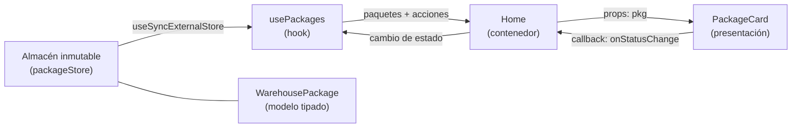

<div align="center">

# LogiTrack Express

**Interfaz híbrida, reactiva y accesible para la recepción, inspección y clasificación de paquetes.**

Desarrollo de Interfaces (0488) · 2.º DAM · Instituto Nebrija · 2026/2027

<br>

[](https://github.com/FabioRieker/Actividad-2-Individual-React/actions/workflows/ci.yml)


</div>

---

## Índice

- [Descripción](#descripción)
- [Stack tecnológico](#stack-tecnológico)
- [Tareas de la actividad](#tareas-de-la-actividad)
- [Arquitectura](#arquitectura)
- [Requisitos e instalación](#requisitos-e-instalación)
- [Scripts](#scripts)
- [Calidad](#calidad)
- [Accesibilidad](#accesibilidad)
- [Despliegue](#despliegue)
- [Evidencias](#evidencias)
- [Flujo de ramas y commits](#flujo-de-ramas-y-commits)
- [Autor y licencia](#autor-y-licencia)

---

## Descripción

Aplicación móvil y de tablet para los operarios de almacén de la empresa ficticia LogiTrack Express. Permite consultar paquetes con código de seguimiento `LTK-XXXX-ES`, hub de destino, peso, prioridad y estado, buscarlos y filtrarlos en tiempo real, y marcarlos como inspeccionados o rechazados con acciones rápidas. Los datos son simulados (sin backend de negocio).

## Stack tecnológico

| Capa              | Tecnología                                 | Versión |
| ----------------- | ------------------------------------------ | ------- |
| UI                | React (componentes funcionales y hooks)    | 19.0.0  |
| UI híbrida        | Ionic React (`@ionic/react`)               | 8.8.21  |
| Nativo            | Capacitor                                  | 8.6.3   |
| Lenguaje          | TypeScript (`strict`)                      | ~5.9    |
| Empaquetador      | Vite                                       | 8.x     |
| Estado            | Almacén inmutable + `useSyncExternalStore` | —       |
| Runtime           | Node.js                                    | 24.21.0 |
| Pruebas unitarias | Vitest + Testing Library + jsdom           | 5.x     |
| Pruebas E2E       | Playwright (canal `chrome`)                | 1.64    |
| Calidad           | ESLint, Prettier, commitlint, husky        | —       |
| CI                | GitHub Actions                             | —       |

## Tareas de la actividad

| Tarea                            | RA / CE                 | Qué se entrega                                                                                                          | Evidencias         |
| -------------------------------- | ----------------------- | ----------------------------------------------------------------------------------------------------------------------- | ------------------ |
| **T1** Andamiaje                 | RA 1 · CE 1.c, 1.d      | Proyecto Ionic React con Vite, modelo `WarehousePackage` y almacén de paquetes con datos mock tipados en `strict`       | `evidence/tarea1/` |
| **T2** Vista declarativa         | RA 2 · CE 2.b, 2.c      | `IonHeader`, `IonSearchbar` e `IonList` con `IonItemSliding`; listas con `map`, condicionales y estado vacío en JSX     | `evidence/tarea2/` |
| **T3** Componente reutilizable   | RA 3 · CE 3.b, 3.c      | `PackageCard` con props tipadas (`pkg`) y callback `onStatusChange`, sin acceso al almacén                              | `evidence/tarea3/` |
| **T4** Accesibilidad WCAG 2.1 AA | RA 4 · CE 4.a, 4.b, 4.c | Auditoría Lighthouse inicial y final, tabla de incumplimientos y correcciones                                           | `evidence/tarea4/` |
| **T5** Búsqueda reactiva         | Transversal RA 1–3      | Búsqueda con RxJS (`debounce` y `distinctUntilChanged`), liberación de suscripciones y filtrado memoizado con `useMemo` | `evidence/tarea5/` |
| **Extra** Despliegue             | Sin CE asignado         | Docker + nginx, `aws-emulator`, CI y Vercel                                                                             | `evidence/fase-f/` |

## Arquitectura

Arquitectura desacoplada basada en componentes: la página contenedora gestiona el estado, el componente hijo solo recibe datos y emite eventos, y el almacén inmutable es la única fuente de verdad.



- `Home` pasa cada paquete a `PackageCard` mediante la prop `pkg` y recibe los eventos mediante el callback `onStatusChange`.
- El almacén guarda un estado inmutable; `usePackages` lo expone a los componentes con `useSyncExternalStore`, y los valores derivados (filtros) se calculan con `useMemo`.
- `PackageCard` no accede al almacén.

## Requisitos e instalación

- [nvm](https://github.com/nvm-sh/nvm) y Node.js 24.21.0 (fijado en `.nvmrc` y en `engines`).
- Para el despliegue local: Docker con Compose v2; para el emulador de AWS, Linux amd64 con glibc 2.17 o superior y AWS CLI v2.

```bash
nvm use          # selecciona Node 24.21.0
npm ci           # instalación reproducible
npm run dev      # servidor de desarrollo de Vite
```

## Scripts

| Script      | Comando                                         | Descripción                                |
| ----------- | ----------------------------------------------- | ------------------------------------------ |
| `dev`       | `vite`                                          | Servidor de desarrollo                     |
| `build`     | `tsc && vite build`                             | Compilación de producción (salida `dist/`) |
| `preview`   | `vite preview`                                  | Previsualización del _build_               |
| `lint`      | `eslint --max-warnings 0 && prettier --check .` | Análisis estático y formato                |
| `lint:fix`  | `eslint --fix && prettier --write .`            | Corrige lo corregible                      |
| `typecheck` | `tsc --noEmit` (app y E2E)                      | Comprobación de tipos                      |
| `test`      | `vitest run`                                    | Pruebas unitarias y de componentes         |
| `test:e2e`  | `playwright test`                               | Pruebas de extremo a extremo               |
| `capture`   | `node scripts/capture.mjs`                      | Captura automatizada de evidencias         |

## Calidad

- **TypeScript estricto:** `strict: true`, sin `any`, sin `@ts-ignore`.
- **ESLint sin avisos:** `--max-warnings 0`.
- **Prettier** para el formato, comprobado en `npm run lint`.
- **Vitest y Testing Library** para pruebas unitarias y de componentes.
- **Conventional Commits** validados con commitlint en el hook `commit-msg` de husky.
- **Integración continua** en GitHub Actions: instalación con `npm ci`, lint, tipos, pruebas y _build_ en el job `verify`.

## Accesibilidad

Objetivo de cumplimiento: **WCAG 2.1 nivel AA**.

- `aria-label` obligatorio en los botones que solo contienen icono (criterio 4.1.2).
- Insignias de estado y prioridad con **texto y color**, nunca solo color (1.4.1).
- Contraste de texto e iconos conforme a AA (1.4.3).
- Foco de teclado visible (2.4.7).

| Auditoría                           | Resultado                       |
| ----------------------------------- | ------------------------------- |
| Lighthouse, Accesibilidad (inicial) | 94 / 100 (tema claro y oscuro)  |
| Lighthouse, Accesibilidad (final)   | 100 / 100 (tema claro y oscuro) |

## Despliegue

Estado: preparado, sin desplegar en Vercel ni en AWS real. Detalle completo en `docs/despliegue.md` de la rama de despliegue.

- **Docker + nginx:** `docker compose up -d --build` sirve la aplicación en http://localhost:8080 (con _fallback_ de SPA y cabeceras de seguridad). Solo se ha ejecutado `docker compose config`; el _build_ de la imagen sigue pendiente.
- **Emulador oficial de AWS (`aws-emulator`):** binario nativo que expone S3, DynamoDB y STS por HTTPS en `127.0.0.1:9297`, sin cuenta ni token. Con el emulador en marcha (`aws-emulator -t off`):

  ```bash
  npm run build
  bash scripts/deploy-aws-emulator.sh
  ```

  El _script_ crea el _bucket_ `logitrack-web`, sube `dist/` con `s3 sync`, crea la tabla `packages` y la siembra con 8 paquetes desde `infra/seed/packages.json`. Es idempotente y se verifica con `aws s3 ls` y `aws dynamodb scan --table-name packages --select COUNT` (esperado: 8). Ejecutado con aws-emulator v1.0.628 y AWS CLI 2.42.4, dos veces con exit 0. El _website hosting_ solo queda como configuración; la aplicación se sirve con nginx.

- **CI del despliegue:** el _workflow_ `docker.yml` incluye el job `aws-emulator-smoke`.
- **Vercel:** `vercel.json` define la salida `dist`, el _rewrite_ de SPA, la caché de `/assets/*` y las cabeceras de seguridad (CSP, `X-Frame-Options`, `nosniff`, HSTS). El despliegue lo lanza el alumno con `vercel --prod`; no se ha ejecutado.

No hay URLs de producción activas.

## Evidencias

La carpeta [`evidence/`](evidence/) agrupa por tarea los artefactos reales generados durante el desarrollo: salidas de lint, tipos, _build_ y pruebas, capturas e informes de Lighthouse.

| Carpeta            | Contenido                                                                                       |
| ------------------ | ----------------------------------------------------------------------------------------------- |
| `evidence/tarea1/` | Logs de creación, versiones, tipos, lint, _build_ y pruebas; captura del servidor de desarrollo |
| `evidence/tarea2/` | Capturas en emulación móvil y consola sin avisos                                                |
| `evidence/tarea3/` | Capturas antes y después de una acción de estado                                                |
| `evidence/tarea4/` | Informes Lighthouse inicial y final                                                             |
| `evidence/tarea5/` | Diff de la refactorización y salidas de lint, tipos, build y pruebas                            |
| `evidence/fase-f/` | Registros del despliegue (`docker compose config`, `aws-emulator`)                              |

`npm run capture` levanta el servidor con Playwright y guarda capturas en `evidence/`.

## Flujo de ramas y commits

| Rama               | Propósito                                          |
| ------------------ | -------------------------------------------------- |
| `main`             | Versión estable y entregable; protegida            |
| `develop`          | Integración; recibe cada tarea terminada           |
| `tarea-<n>-<slug>` | Una rama por tarea (por ejemplo `tarea-3-tarjeta`) |

Toda integración se hace mediante _pull request_ con el check `verify` obligatorio y _merge commit_. Los mensajes siguen [Conventional Commits](https://www.conventionalcommits.org/es/v1.0.0/) en español, con cabecera de máximo 72 caracteres y sin punto final:

```text
feat(tarjeta): añadir callback onStatusChange al componente PackageCard
docs(evidencia): añadir evidencias de la tarea 1
```

## Autor y licencia

**Fabio Rieker** · 2.º DAM · Instituto Nebrija

Proyecto académico, de uso educativo.
