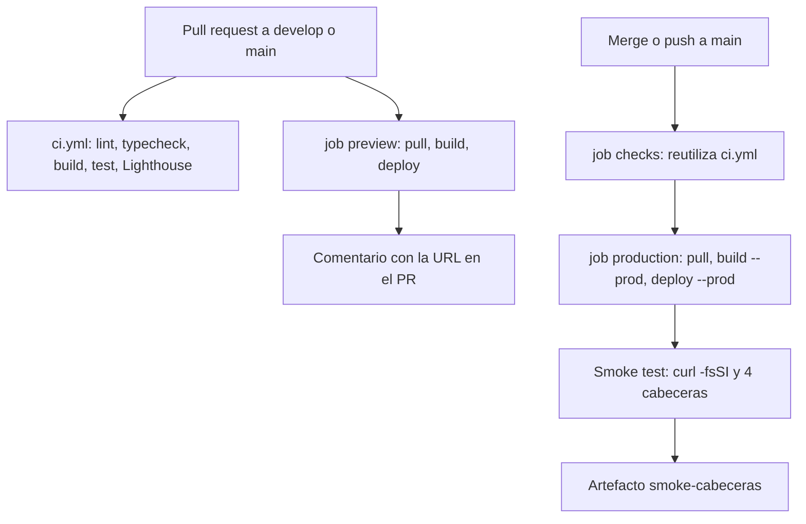

# Despliegue: Docker local, emulador de AWS y Vercel

Estado: **preparado** (no desplegado en Vercel ni en AWS real). La app es Ionic React con Vite: `npm run build` emite en `dist/`.

## Arquitectura

| Pieza                                                               | Qué hace                                                                                                             | Puerto       |
| ------------------------------------------------------------------- | -------------------------------------------------------------------------------------------------------------------- | ------------ |
| `Dockerfile` + `nginx.conf` + `docker-compose.yml` (servicio `web`) | Compila y sirve la app con nginx (fallback SPA)                                                                      | 8080         |
| `aws-emulator` (emulador oficial de AWS, binario nativo)            | Emula S3, DynamoDB y STS en local, sin cuenta ni Docker                                                              | 9297 (HTTPS) |
| `scripts/deploy-aws-emulator.sh`                                    | Crea el bucket `logitrack-web`, sube `dist/`, crea la tabla `packages` y la siembra desde `infra/seed/packages.json` | -            |
| `vercel.json`                                                       | Salida `dist`, rewrite SPA, cabeceras y caché                                                                        | -            |

El emulador guarda todo en memoria: al pararlo se pierde el estado y hay que volver a ejecutar el script.

## Requisitos

- Docker y Docker Compose v2 (para `web`).
- Node 24.21.0 (`.nvmrc`).
- Linux amd64 con glibc >= 2.17 para el emulador.
- AWS CLI v2 (en `ubuntu-latest` ya viene instalado).
- Sin claves reales: el emulador genera credenciales temporales en `~/.aws/emulator/9297/` y el script las usa; `AWS_ACCESS_KEY_ID` y similares se anulan (`unset`).

## Instalación del emulador (una vez, requiere sudo)

```bash
curl -fsSLo aws-emulator.deb https://downloads.aws.com/aws-emulator/packages/aws-emulator/LTS/latest/aws-emulator_amd64.deb
sudo apt-get install -y ./aws-emulator.deb
aws-emulator -v
```

El paquete pesa unos 218 MB. Sin sudo se puede extraer con `dpkg-deb -x aws-emulator.deb <carpeta>` y ejecutar `<carpeta>/opt/aws-emulator/bin/aws-emulator`.

AWS CLI v2 en modo usuario (sin sudo):

```bash
curl -fsSLo awscliv2.zip https://awscli.amazonaws.com/awscli-exe-linux-x86_64.zip
unzip -q awscliv2.zip && ./aws/install -i ~/.local/aws-cli -b ~/.local/bin
```

## Comandos

Scripts de `package.json`:

```json
"deploy:local": "npm run build && docker compose up -d --build",
"deploy:aws-emulator": "npm run build && bash scripts/deploy-aws-emulator.sh"
```

Equivalen a los pasos manuales:

1. App en Docker: `npm run build && docker compose up -d --build` y abrir http://localhost:8080. Parar con `docker compose down`.
2. Emulador: en otra terminal `aws-emulator -t off` (`-t off` desactiva la telemetría).
3. Despliegue en el emulador: `npm run build && bash scripts/deploy-aws-emulator.sh`. Es idempotente.
4. Comprobación manual (tras exportar las variables que fija el script):
   `aws s3 ls`, `aws dynamodb scan --table-name packages --select COUNT` (esperado: 8).
5. Health: `curl --cacert ~/.aws/emulator/9297/ca.pem https://127.0.0.1:9297/__admin/health`.

Variables opcionales del script: `EMULATOR_PORT`, `EMULATOR_DIR`, `BUCKET`, `DIST_DIR`, `SEED_FILE`.
Usar siempre `127.0.0.1` y no `localhost` con S3.

## Soporte de servicios (confirmado)

Fuentes de la investigación y resultado, con la versión 1.0.628 (2026-11-26):

| Operación                                                    | Soportada                   | Evidencia                                                                                                                                                                                              |
| ------------------------------------------------------------ | --------------------------- | ------------------------------------------------------------------------------------------------------------------------------------------------------------------------------------------------------ |
| STS `GetCallerIdentity`                                      | Sí                          | Ejecutado: cuenta `000000000000`                                                                                                                                                                       |
| S3 `CreateBucket`, `HeadBucket`, `ListBuckets`               | Sí                          | Ejecutado; 535 tests de fidelidad usan `CreateBucket`                                                                                                                                                  |
| S3 `PutObject` / `GetObject` / `ListObjectsV2` (y `s3 sync`) | Sí                          | Ejecutado (`s3 sync`, `s3 cp`, `s3 ls`); 335 / 242 / 317 tests de fidelidad                                                                                                                            |
| S3 `PutBucketWebsite` / `GetBucketWebsite`                   | Sí, solo como configuración | Ejecutado: se guarda y se lee. Servir el sitio no queda verificado: la petición anónima a `https://127.0.0.1:9297/` con cabecera `Host: logitrack-web.s3-website.us-east-1.amazonaws.com` devuelve 403 |
| S3 `PutBucketPolicy` público                                 | No (bloqueado)              | Ejecutado: `AccessDenied` por Block Public Access, igual que AWS real                                                                                                                                  |
| DynamoDB `CreateTable` / `DescribeTable`                     | Sí                          | Ejecutado; 1132 tests de fidelidad                                                                                                                                                                     |
| DynamoDB `BatchWriteItem`                                    | Sí                          | Ejecutado (8 elementos); 75 tests                                                                                                                                                                      |
| DynamoDB `PutItem`                                           | Sí                          | 824 tests de fidelidad (no ejecutado directamente)                                                                                                                                                     |
| DynamoDB `Scan` (`--select COUNT`)                           | Sí                          | Ejecutado: Count 8; 177 tests                                                                                                                                                                          |

Limitaciones reales:

- La app en el emulador se considera almacenada y verificada por API (`s3 ls`, `s3 cp`), no servida por una URL pública. La URL de la app es nginx en el puerto 8080.
- Todo el estado es volátil (memoria).
- Una operación no implementada devuelve HTTP 501 `NotImplemented`.
- El emulador es para desarrollo y pruebas; no es válido para producción ni para pruebas de seguridad.
- Los gaps de fidelidad se publican en `issues/` del repositorio y en las puntuaciones de cada release.

### Fuentes

- Guía de instalación en Linux: https://docs.aws.amazon.com/emulator/latest/userguide/getting-started-linux.html
- Comprobar si un proyecto funciona: https://docs.aws.amazon.com/emulator/latest/userguide/check-project.html
- Repositorio y README (alcance, puerto 9297, telemetría, `issues/`): https://github.com/aws/aws-emulator
- Releases (v1.0.628, puntuaciones de fidelidad): https://github.com/aws/aws-emulator/releases
- Casos de fidelidad (`manifest.jsonl`, operaciones S3 y DynamoDB cubiertas): https://github.com/aws/aws-emulator-evaluation-suite

## Vercel

`vercel.json`: framework `vite`, `installCommand` `npm ci`, `buildCommand` `npm run build`, `outputDirectory` `dist`, rewrite SPA a `/index.html`, caché inmutable en `/assets/*` y las cabeceras de seguridad. `.vercelignore` excluye del envío lo que no hace falta para compilar. El despliegue lo lanza el alumno; no se ha ejecutado.

Pasos exactos (desde la raíz del proyecto):

1. `npx vercel login`: autenticación (correo o proveedor Git) en el navegador.
2. `npx vercel link`: crear o enlazar el proyecto. Responder: ámbito personal, proyecto nuevo, directorio `./`. Los ajustes se leen de `vercel.json`.
3. `npx vercel`: despliegue de vista previa. Imprime una URL `https://<proyecto>-<hash>.vercel.app`.
4. `npx vercel --prod`: despliegue a producción (alias `https://<proyecto>.vercel.app`).

Conexión Git opcional: en el panel de Vercel, proyecto, Settings, Git, conectar el repositorio y fijar la rama de producción en `main`. Cada push a `main` despliega a producción y el resto de ramas y PR generan vistas previas.

Verificación tras desplegar:

```bash
curl -I https://<url>/
curl -I https://<url>/assets/<fichero-con-hash>.js
curl -sI https://<url>/ruta/inexistente | head -n 1
```

Cabeceras esperadas en `/`:

- `content-security-policy: default-src 'self'; script-src 'self'; style-src 'self' 'unsafe-inline'; img-src 'self' data:; font-src 'self' data:; connect-src 'self'; object-src 'none'; base-uri 'self'; form-action 'self'; frame-ancestors 'none'`
- `x-frame-options: DENY`
- `x-content-type-options: nosniff`
- `referrer-policy: strict-origin-when-cross-origin`
- `permissions-policy: accelerometer=(), camera=(), geolocation=(), gyroscope=(), microphone=(), payment=(), usb=()`
- `strict-transport-security: max-age=63072000; includeSubDomains; preload`

En `/assets/*` además: `cache-control: public, max-age=31536000, immutable`. Una ruta inexistente debe responder `200` (rewrite SPA). Después, abrir la URL con la consola del navegador y confirmar que no hay mensajes de Content Security Policy.

Nota sobre la CSP: se eliminó `@vitejs/plugin-legacy` porque inyectaba scripts en línea y un `data:` en `index.html` que la CSP (`script-src 'self'`) bloquea y dejaba la app en blanco. Los navegadores objetivo (`.browserslistrc`) soportan módulos ES.

`npx vercel build` no se ejecutó: exige sesión y enlace de proyecto (`vercel pull`). La comprobación se hizo sirviendo `dist/` con nginx y las mismas cabeceras (ver más abajo).

## Cabeceras y CSP

Definidas en `vercel.json` y `nginx/security-headers.conf` (mantener sincronizadas):

- `script-src 'self'`: Vite emite `<script type="module" src="/assets/...">` externos, sin scripts inline.
- `style-src 'self' 'unsafe-inline'`: Ionic (web components) y React aplican estilos en línea en ejecución; sin esto la UI se rompe.
- `connect-src 'self'`, `img-src 'self' data:`, `font-src 'self' data:`, `object-src 'none'`, `frame-ancestors 'none'`.
- `X-Frame-Options: DENY`, `X-Content-Type-Options: nosniff`, `Referrer-Policy`, `Permissions-Policy`, HSTS.

## CI

`.github/workflows/docker.yml` (`permissions: contents: read`, `concurrency`, `timeout-minutes`):

- `docker`: construye la imagen, la sirve con nginx y comprueba respuesta, cabecera `nosniff` y fallback SPA.
- `aws-emulator-smoke`: descarga el `.deb`, registra su sha256 (el proveedor no publica uno oficial), lo instala con `sudo apt-get`, arranca el emulador en segundo plano, espera el health, y construye el `dist/` real (`npm ci` y `npm run build`), ejecuta dos veces el script y comprueba Count 8. Sube el log del emulador como artefacto `aws-emulator-logs`.

## Despliegue continuo (CD)

`.github/workflows/cd.yml` despliega con la CLI de Vercel fijada en la versión 67.0.0. `ci.yml` es reutilizable (`workflow_call`) sin perder sus disparadores.



Comportamiento:

- Si falta algún secreto (`VERCEL_TOKEN`, `VERCEL_ORG_ID`, `VERCEL_PROJECT_ID`), los jobs `preview` y `production` emiten un `::notice::` y omiten sus pasos sin fallar, de modo que los PR no se rompen hasta configurarlos.
- `preview`: `pull-requests: write` solo en ese job; la concurrencia cancela la ejecución anterior del mismo PR.
- `production`: `environment: production` con la URL desplegada; no cancela despliegues en curso. El smoke test falla si falta `content-security-policy`, `strict-transport-security`, `x-frame-options` o `x-content-type-options`.
- Las URL `*.vercel.app` de despliegue pueden estar tras la protección de despliegues de Vercel y responder 401 sin esas cabeceras. Si ocurre, define la variable de repositorio `PRODUCTION_URL` con el dominio público de producción (el smoke test la usa en lugar de la URL del despliegue) o desactiva la protección para producción.
- Evitar duplicados: en Vercel, proyecto, Settings, Git, desactivar el despliegue automático (por ejemplo con "Ignored Build Step" en `exit 0`, o desconectando el repositorio). Alternativa: mantener la integración Git para las vistas previas y dejar este workflow solo para producción, eliminando el job `preview`.

Pasos para el alumno (el `.vercel/` está en `.gitignore` y no se versiona):

1. Crear un token en https://vercel.com/account/tokens.
2. `npx vercel login` y `npx vercel link` en la raíz; leer `orgId` y `projectId` de `.vercel/project.json`.
3. Registrar los secretos:

```bash
gh secret set VERCEL_TOKEN -R FabioRieker/Actividad-2-Individual-React
gh secret set VERCEL_ORG_ID -R FabioRieker/Actividad-2-Individual-React
gh secret set VERCEL_PROJECT_ID -R FabioRieker/Actividad-2-Individual-React
```

4. Crear en GitHub el entorno `production` (Settings, Environments), opcionalmente con revisores requeridos.
5. Abrir un PR para ver la vista previa y fusionar a `main` para producción.

## Verificación realizada (evidence/fase-f/)

- `docker-compose-config.log`: salida de `docker compose config` (exit 0).
- `docker-up.log` (Docker 29.9.3, Compose v5.0.1): `docker compose build` exit 0, `up -d` exit 0, contenedor `healthy`, `curl -sI http://localhost:8080/` devuelve 200 con CSP, `X-Frame-Options: DENY`, `X-Content-Type-Options: nosniff`, `Referrer-Policy`, `Permissions-Policy` y HSTS; `/ruta-inexistente` devuelve 200 con el mismo `index.html` (fallback SPA); `docker compose down` exit 0.
- `aws-emulator-deploy.log` (emulador 1.0.628, AWS CLI 2.42.4, Node 24.21.0): `npm run deploy:aws-emulator` con el `dist/` real, exit 0. Bucket `logitrack-web` con 15 objetos (2958072 bytes), tabla `packages` con Count 8. Segunda ejecución idempotente (exit 0). Al terminar se paró el emulador y no quedó proceso ni el puerto 9297 abierto.

- `csp-chrome.log`: Chrome estable headless (Playwright, canal `chrome`) contra la imagen nginx en `/` y `/ruta/spa`: consola vacía, 0 violaciones CSP. Antes de quitar el plugin legacy había 6 violaciones.

## Pendiente

- Instalar el emulador de forma permanente con `sudo apt-get install -y ./aws-emulator.deb` (el alumno); la verificación se hizo con el binario extraído sin instalar.
- Ejecución del workflow en GitHub (el job `aws-emulator-smoke` ahora construye el `dist/` real con `npm ci` y `npm run build`).
- `shellcheck` no está instalado en la máquina: `sudo apt-get install -y shellcheck && shellcheck scripts/deploy-aws-emulator.sh`.
- Despliegue en Vercel (pasos en la sección Vercel): no ejecutado, lo hace el alumno.
- CD a Vercel: configurar los secretos y el entorno `production` (sección Despliegue continuo); el workflow `cd.yml` no se ha ejecutado.
